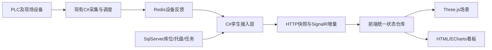

# WCS 立体库数字孪生系统 · 功能模块拆解与实施方案

更新日期：2026-11-07。本文按当前页面、两层平面图、Redis 变量定义及任务查询脚本整理。

首期方案：**C# ASP.NET Core 通过 S7 长连接直读 PLC，并按需汇聚 Redis/SqlServer；HTTP 提供配置、状态与初始化快照，SignalR 推送变化，浏览器使用 Three.js 渲染、HTML/ECharts 展示看板。**

| 阅读内容 | 章节 |
|----------|------|
| 当前已实现与待实现的范围 | [0. 状态与范围](#status) |
| 共用设备、连续货架和地址规则 | [1. 规模与模型](#model) |
| M01–M09 职责及后续能力 | [2. 功能模块](#modules) |
| 设备反馈、业务数据与前端关系 | [3. 总体架构](#architecture) |
| 实际 Redis 变量名与编号差异 | [4. 设备来源](#redis) |
| C# 采集、SQL 同步和部署 | [5. 后端接入](#backend) |
| 接口、消息和重连同步 | [6. 数据协议](#protocol) |
| 现有模型的渲染与实时改造 | [7. 3D 实现](#rendering) |
| 看板指标和统计口径 | [8. 数据看板](#dashboard) |
| 实施顺序与现场验收 | [9. 实施验收](#delivery) |
| 尚需补齐的资料 | [10. 待确认项](#open-items) |
| 项目文件与消息样例 | [附录 A](#files)、[附录 B](#message-examples) |

<a id="status"></a>

## 0. 当前状态与项目范围

### 0.1 状态定义与目标

| 状态 | 当前对应内容 |
|------|--------------|
| 已实现演示 | 共享 TC、连续货架、输送设备编号、交互定位、模拟任务/报警和深色数据看板 |
| 已确认资料 | 三份 Redis 变量定义、图纸编号集合、TN_WCS_MainMission 查询脚本 |
| 已实现接入基础 | 模块化 C# S7 只读网关、JSON 点位模板、TC 快捷接入、多设备/多 DB 调度、配置迁移与原子保存、点位质量/过期标记、断线重连；已通过本机 S7 协议模拟，尚需现场真机联调 |
| 已选定但待实现 | 全库 HTTP/SignalR 状态投影、S7 数据到三维模型的绑定、前端差量更新与渲染优化 |
| 待现场确认 | 库位/库存/托盘表、Redis 存储与实时样本、TC02–TC05 来源、状态字典、坐标标定及编号差异 |

首期以设备采样或业务提交到前端可见变化不超过 2s 为验收目标，取数周期与硬件表现须现场验证。没有可信源时间时只能测量网关到前端的延迟，不能宣称测得 PLC 端到端延迟。

### 0.2 当前已实现的演示功能

| 范围 | 当前页面能力 |
|------|--------------|
| 空间模型 | 1F/2F/双层切换、连续10层货架、交界层板共用、外侧二层输送平台 |
| 设备与库位 | 图纸编号模型、全库共用5台TC、2000个原型货位、区内/连续层号及占用色 |
| 定位交互 | 输送编号检索，设备/库位点击详情，场景高亮，总览/俯视/巷道视角 |
| 演示运行 | 本地入库/出库/移库任务、堆垛机行走/升降及取放货表现、循环托盘、模拟报警及自动解除 |
| 状态与指标 | 巷道负载、占用率、运行任务和报警记录；共享设备不因楼层切换重复创建 |
| 数据看板 | 本地ECharts深色大屏，7个图表加统计卡/列表，支持总览/任务/库位/报警聚焦 |
| 告警定位 | 从看板告警返回3D，定位堆垛机/输送设备/库位；Esc或“返回孪生”退出看板 |

这些是已实现的演示能力。随机库存、模拟任务、自动清警和历史基线仍在使用；真实设备反馈、SQL库存/任务与真实历史统计尚未接入，替换范围见7.7。

<a id="model"></a>

## 1. 项目规模与统一模型

### 1.1 图纸基线与统一规模

| 项目 | 1F | 2F |
|------|----|----|
| 巷道数 | 5（A01–A05） | 5（A01–A05） |
| 货架排数 | 10 排（每巷 2 排） | 10 排（每巷 2 排） |
| 堆垛机 | TC01–TC05，全库共 5 台，跨两层服务 | 与 1F 共用同一组设备、任务状态与报警；按用户确认统一 A01–A05 对应 TC01–TC05 |
| 输送线编号段 | 1001–1100，共 96 个图示设备（图纸未出现 1005、1030、1052、1098） | 2001–2056，共 56 个图示设备 |
| 巷道口工位 | 每排货架左端 1 个工位，绿/蓝箭头区分入库/出库方向 | 同左 |
| 纵向主干 | 双纵向输送及转接网络，设备类型按台账核实 | 双纵向输送及转接网络 |
| 状态图例 | 自动=绿 / 任务·暂停=黄 / 报警=红 | 同左 |

货位地址采用 `仓库 → 巷道 → 排（左右侧） → 列 → 连续层`，楼层/上下区作为筛选属性。每排货架左端有独立双段支线，工位与货位通过任务起终点关联；工位不是库位地址层级的父节点。1F/2F表中巷道与货架排描述的是同一组平面位置，不叠加统计为10巷道或20排。

| 统计口径 | 数量与含义 |
|----------|------------|
| 物理模型 | 全库5巷道、10排连续货架，TC01–TC05共5台，跨两区共用 |
| 原型货位 | 5巷道 × 2排 × 20列 × 连续10层 = 2000个，每区1000个；实际容量/尺寸待主数据核对 |
| 图纸模型输送设备 | 1F 96个 + 2F 56个 = 152个 |
| 变量表源编号 | CV01 100个 + CV02 55个 = 155个，属于变量定义覆盖，不是在线数 |
| 候选映射 | 按编号规律覆盖151/152个模型设备；一楼4个源编号无图示位置，二楼2056缺来源，见4.2 |
| TC 来源覆盖 | 文件只有TC01的46项定义；其余四台不能直接视为已取得来源 |

尚未确认独立提升机、穿梭车或AGV台账，不能根据输送段编号推断其类型。1F/2F是页面中的上下区分组，货架在中间连续相接，并非两组中间留空的独立货架。

### 1.2 实体身份、地址与高度

| 对象 | 接口标识 | 与当前页面对应 |
|------|----------|----------------|
| 仓库 | `warehouseId`，例如 `WH01` | 隔离不同仓库的数据 |
| 输送设备 | 字符串 `deviceId`，例如 `1001`、`2056` | 对应 `F.conveyors` 中的 `id`，每个编号绑定一个设备对象 |
| 堆垛机 | `TC01`–`TC05` | 对应 `sharedCranes`；全库只有 5 台，不生成 `1F-TC01` / `2F-TC01` 两份状态 |
| 业务库位 | 数据库稳定主键 `cellId`，另传 `cellCode` 和 `modelCode` | 通过映射表找到 `F.cells`；不能假设数据库编码就是当前演示编码 |
| 托盘 | `palletId` / `trayCode` | 同一托盘跨输送机、堆垛机和库位时保持同一身份 |
| 任务 | `taskId` 使用稳定主键，`taskNo` 为展示编号 | 优先对接 `S_ID`，展示 `S_TASK_NO`，同时带上仓库范围 |

设备实体按 `(warehouseId, deviceId)` 唯一，其他对象也限定仓库范围。逻辑设备保留独立状态，合批后的渲染句柄可以有多个，见7.3。编号模型使用 `assets/conveyor-layout.js` 的显式集合；未知来源不匹配“相近编号”，图纸/来源差异按4.2核实后更新。

**连续货架的地址与高度规则：**

- 当前原型共 2000 个货位、每排 20 列，这仍是模型参数，需与真实库位主数据核对；不能直接把这个数量当作现场库存容量。
- 页面 `level` 是区内零基层号 0–4，`rackLevel` 是连续货架层号 1–10：1F 对应 1–5 层，2F 对应 6–10 层。接口中的层号采用一基，并写清是区内层还是全架层。
- 若后台提供连续物理层号，则 `rackLevel=6` 对应 `floor=2、floorLevel=1`；不能再加一次五层偏移。
- 若后台给的是区内层号，则 `rackLevel=(floor-1)×5+floorLevel`；列、左右侧及巷道也要显式映射。
- PLC 编码器值先按现场标定换算为统一的 `xM / yM`，然后转换为模型坐标。共享堆垛机的 `yM` 以全架底部为原点，不随当前页面的楼层切换而改变。
- 当前模型按 `x=(bay-0.5)×bayW`、`y=(rackLevel-0.5)×levelH` 计算货位中心，仅用于解释现有坐标；实际尺寸、零点、正反方向须通过标定配置替换。单位换算与楼层偏移各执行一次。

<a id="modules"></a>

## 2. 功能模块拆解（M01–M09）

以下是能力规划目录，不等于当前实现清单。首期聚焦主数据、现有来源接入、状态同步、3D监控、告警和必要统计。新增传感器/视频/移动端、预测维护及策略仿真属于后续可选范围，当前实现以第0章为准。

### M01 空间建模与主数据

| 子模块 | 关键功能 | 说明 |
|--------|----------|------|
| M01-1 空间建模 | 仓库/巷道/排/列/连续层及上下区视图 | 与图纸一一对应，库位编码规则可配置 |
| M01-2 设备台账 | 堆垛机、输送线、提升机、穿梭车、AGV 的编号/参数/归属巷道 | TC01–TC05 双向映射 |
| M01-3 模型资源管理 | 参数化模型与可选GLB资产、材质复用、坐标和尺寸标定 | 关键设备保留运动机构，重复构件批量绘制 |
| M01-4 孪生体绑定 | 模型节点 ↔ 设备 ID ↔ 实时数据点（tag）三向绑定 | 绑错=孪生失效，需配置化+校验 |
| M01-5 货品主数据 | SKU、批次、托盘码、尺寸/重量 | 决定库位适配与堆码形状 |

### M02 数据接入层

| 子模块 | 关键功能 |
|--------|----------|
| M02-1 WCS 适配器 | 复用C#来源与SQL业务数据，经HTTP快照/查询和SignalR推送到页面 |
| M02-2 WMS 适配器 | 库存快照、出入库单据、库位占用变更 |
| M02-3 PLC/设备直连 | 首期复用现有C#→Redis采集；其他PLC协议适配按需扩展 |
| M02-4 感知设备接入 | RFID/条码（货物识别）、光电/限位（到位信号）、温湿度 |
| M02-5 视频接入 | RTSP/GB28181 拉流、点位标定 |
| M02-6 定位接入 | 人员/叉车定位按后续设备方案与现场标定接入 |
| M02-7 数据治理 | 断线重连、指令去重、乱序处理、时间戳对齐、质量告警 |

### M03 实时通信与状态同步

| 子模块 | 关键功能 |
|--------|----------|
| M03-1 状态总线 | HTTP 初始化快照 + SignalR 增量推送，前端按实体批量刷新 |
| M03-2 指令-动画映射 | 真实反馈驱动位置，任务关联业务及目标高亮；演示模式独立模拟 |
| M03-3 状态机同步 | 设备状态（自动/任务/暂停/报警/离线）+ 任务阶段（取货/行走/升降/放货） |
| M03-4 位置插值 | 上报坐标 → 渲染坐标平滑插值，避免跳变 |
| M03-5 断线恢复 | 首期重连后按快照切点重同步；后续按需扩展持久化补发，旧序号不覆盖新状态 |
| M03-6 时钟同步 | 服务端时基，回放与实时同一套时间轴 |

### M04 3D 场景与渲染引擎

| 子模块 | 关键功能 |
|--------|----------|
| M04-1 场景组织 | 楼层/巷道分块，按视锥加载 |
| M04-2 库位渲染 | 实例化货位，支持占用/空/锁定/禁用/未知；性能以实机验收为准 |
| M04-3 设备动画 | 堆垛机行走+升降+货叉、输送线货物流动、提升机上下 |
| M04-4 摄像机系统 | 总览/俯视/巷道/设备聚焦/第一人称巡检，平滑转场 |
| M04-5 标注系统 | 设备编号、巷道号、库位号、告警气泡 |
| M04-6 视觉增强 | 地面网格、轮廓高亮、库位热力图、半透明楼层 |

### M05 监控与告警

| 子模块 | 关键功能 |
|--------|----------|
| M05-1 设备状态着色 | 自动=绿；任务/暂停=黄；报警=红；离线=灰（与图纸图例一致） |
| M05-2 告警中心 | 分级（提示/警告/严重）、去重、确认、派单 |
| M05-3 报警聚焦 | 报警定位、可选镜头跟随和声光提示，避免打断当前操作 |
| M05-4 报警回放 | 报警前后 30s 场景与数据快照 |
| M05-5 预测性维护 | 电机电流/振动/运行时长趋势，异常提前预警 |

### M06 业务可视化

| 子模块 | 关键功能 |
|--------|----------|
| M06-1 库区总览 | 楼层切换、库位占用率、各巷道负载、吞吐 KPI |
| M06-2 巷道视图 | 单巷道剖面：每层每列库位占用、堆垛机实时位置 |
| M06-3 出入库工艺仿真 | 本项目已知路径为输送工位→共用堆垛机→目标库位，出库反向；独立提升机等设备仅在台账确认后扩展 |
| M06-4 任务追踪 | 单托盘全链路轨迹（时间轴 + 3D 定位） |
| M06-5 库存查询 | 按 SKU/批次/托盘码模糊或精确检索，库位高亮聚焦 |
| M06-6 输送线监控 | 段占用、堵塞点、流量热力 |
| M06-7 库位优化 | 按出入库频率 ABC 分析，给出库位调整建议（拖拽预演） |

### M07 仿真与推演

| 子模块 | 关键功能 |
|--------|----------|
| M07-1 节拍仿真 | 按任务量推算堆垛机/输送线产能瓶颈 |
| M07-2 What-if | 增减设备、改巷道分配策略后的吞吐对比 |
| M07-3 调度策略验证 | 先进先出 / 就近库位 / 分区存放 三种策略跑分 |
| M07-4 培训模式 | 操作工在孪生体上练习异常处置 |

### M08 交互与多端

| 子模块 | 关键功能 |
|--------|----------|
| M08-1 大屏模式 | 1920/4K 自适应，中间 3D + 两侧图表 |
| M08-2 PC 客户端 | 完整操作与配置 |
| M08-3 移动端 | 告警推送、扫码查库位 |
| M08-4 视频融合 | 摄像头画面贴合到 3D 场景对应位置 |
| M08-5 权限与审计 | 角色（值班/主管/运维）、操作留痕 |

### M09 数据服务与报表

| 子模块 | 关键功能 |
|--------|----------|
| M09-1 指标计算 | 吞吐量、任务平均时长、设备利用率/OEE、库位周转率、故障率 |
| M09-2 报表 | 日报/班报/月报，导出 Excel/PDF |
| M09-3 开放 API | 向 MES/ERP 提供孪生侧数据 |
| M09-4 时序存储 | 设备状态/位置/报警持久化；保留周期按回放需求与存储能力确定 |

<a id="architecture"></a>

## 3. 总体架构与数据职责

### 3.1 数据流与职责



现有C#继续承担设备控制和任务调度，接入层读取、解码、归一化和广播，浏览器负责展示交互。首期复用已有PLC采集链路，展示端不另起实际调度循环。

### 3.2 权威数据来源

| 数据 | 权威来源 | 前端使用方式 |
|------|----------|--------------|
| 输送机运行、模式、占位、阻塞、光电、当前条码、报警 | Redis 中后台采集的设备反馈 | 设备颜色、占位托盘、详情、报警提示 |
| TC01–TC05 行走位置、升降位置、货叉、载货、模式、报警 | Redis 中实测状态 | 驱动共用堆垛机模型及状态灯 |
| 库位是否占用、锁定、禁用、库存数量 | SqlServer 中库位/库存业务记录 | 库位着色、占用率、库存详情 |
| 托盘主数据、物料、批次及账面位置 | SqlServer 中托盘/库存业务记录 | 按托盘编号关联货品与库位 |
| 任务号、类型、起终点、优先级、业务状态 | `TN_WCS_MainMission` 及必要关联表 | 任务列表、目标位置高亮、业务进度 |
| 设备号、巷道、物理坐标与模型坐标映射 | 经核对的主数据/配置 | 将上述数据绑定到正确的模型 |

**任务描述“计划做什么”，设备反馈描述“实际到了哪里”，库存记录描述“业务已经确认什么”。** 任务下发不能直接让前端认定取货成功；任务完成也不能代替库存表更新。数据库的任务阶段不能伪装成 PLC 实测位置。

设备“有货但没有条码”应显示占位、身份未知，不能显示空位。Redis 条码与 SQL 账面托盘暂不一致时，分别保留 `reportedTrayCode` 和账面位置并标注待核对，不能悄悄覆盖，也不能重复计入库存。

### 3.3 功能层次

```
L5 展示层    大屏 / PC 客户端 / 移动端 / 视频墙
L4 孪生应用  库区总览 · 巷道监控 · 设备聚焦 · 任务追踪 · 告警中心 · 回放复盘 · 仿真推演
L3 孪生引擎  3D 渲染 · 动画栈调度 · 状态机同步 · 空间索引 · LOD/分块加载
L2 数据服务  实时状态总线 · 时序库 · 主数据 · 事件流 · 指标计算
L1 接入层    WCS / WMS / PLC / 传感器 / RFID / 视频 / 定位 适配器
L0 物理层    堆垛机 · 输送线 · 提升机 · 穿梭车 · 货架 · 货物
```

<a id="redis"></a>

## 4. Redis 设备来源与字段映射

### 4.1 来源文件与定义

以“设备变量”工作表的 **G 列 Redis变量名**作为设备采集来源标识，B 列是采集变量名，C 列是声明类型，D 列是 PLC 地址，E 列是采集长度，H 列是描述。这些是变量定义，三表 I 列“数据”未提供实时值，不能据此判断当前设备是否运行或有货。

| 来源文件 | 已核对范围 | 已有内容 |
|----------|------------|----------|
| [1FINFO.xlsx](C:/Users/HCGC/Desktop/1FINFO.xlsx) | `设备变量!A1:I302` | 301 项：`CV01` 公共心跳 1 项，源编号 `101001–101100` 每个状态/占位/条码各 1 项，共 100 个源设备编号 |
| [2FINFO.xlsx](C:/Users/HCGC/Desktop/2FINFO.xlsx) | `设备变量!A1:I167` | 166 项：`CV02` 公共心跳 1 项，源编号 `202001–202055` 每个三项，共 55 个源设备编号 |
| [TC.xlsx](C:/Users/HCGC/Desktop/TC.xlsx) | `设备变量!A1:I47` | 46 项，只有 `TC01.*`：17 项 `WCS_*`、29 项 `PLC_*`；未提供其他四台的实际变量表 |

三表合计 513 项变量定义。`是否触发=False` 只是配置内容，不能推导为无数据变化或无订阅能力，也不能当作设备实时值；变量块中的周期配置同样不能直接证明后台实际采样周期。

### 4.2 输送设备字段和编号差异

| 标准数据 | 一楼原始变量名示例 | 二楼原始变量名示例 | 文件声明与处理 |
|----------|--------------------|--------------------|----------------|
| `rawState → state/mode` | `CV01.PLC_STATUS_STATE_101001` | `CV02.PLC_STATUS_STATE_202001` | UInt16；只写“设备状态”，尚无枚举或 bit 定义，先保留原值，不能自行指定绿/黄/红 |
| `rawHasGoods → occupied` | `CV01.PLC_STATUS_HASGOODS_101001` | `CV02.PLC_STATUS_HASGOODS_202001` | UInt16；只写“有无货状态”，确认有效值后再转 Boolean，不能直接做非零即有货 |
| `reportedTrayCode` | `CV01.PLC_STATUS_CONTNO_101001` | `CV02.PLC_STATUS_CONTNO_202001` | String，声明长度 10；采集器的长度单位、编码与填充处理待核，前端保留条码字符串及前导零 |
| 所属采集组心跳 | `CV01.PLC_STATUS_HEART` | `CV02.PLC_STATUS_HEART` | UInt16，公共心跳；用于判断对应来源组的新鲜度，不是每台输送机独立心跳 |

上述样例分别位于两份输送线表的 `G2:H5`。其余设备按表中实际列出的完整变量名绑定，不按不存在的编号补造来源。

**候选编号对应关系：** 按本批文件的编号规律，一楼 `101001 → 1001`、`101100 → 1100`，二楼 `202001 → 2001`、`202055 → 2055`；这是源编号与图纸编号的对应推导，需点位联调确认后固化为显式映射表，不能把截取末四位作为所有现场设备通用规则。

| 比对项 | 变量表 | 当前图纸模型 | 接入处理 |
|--------|--------|--------------|----------|
| 一楼常规匹配 | 100 个源设备 | 96 个图示设备 | 按候选编号规则可覆盖 96 个图示设备 |
| 一楼仅变量表出现 | `101005 / 101030 / 101052 / 101098` | 图纸没有 `1005 / 1030 / 1052 / 1098` | 来源保留在台账，标为模型未绑定；确认备用/遗漏/实际设备身份，不凭表擅自画到未知位置 |
| 二楼常规匹配 | 55 个源设备 | 56 个图示设备 | 按候选规则可覆盖 2001–2055 |
| 二楼仅图纸出现 | 本表没有 `202056` 的三项变量 | 模型有 `2056` | 标记来源未绑定/未知，不假装自动运行；需要补充实际变量名或确认图纸编号 |

按上述候选规则，152 个模型输送设备中有 151 个具备变量定义候选；另外有 4 个源设备暂无图示位置。这里统计的是配置覆盖，不代表已连通或已验证在线。

绑定配置结构示例（本例设备编号对应关系待现场核实，来源名称取自原表）：

```json
{
  "deviceId": "1001",
  "sourceGroup": "CV01",
  "sourceDeviceId": "101001",
  "mappingStatus": "pendingVerification",
  "sourceTags": {
    "state": "CV01.PLC_STATUS_STATE_101001",
    "hasGoods": "CV01.PLC_STATUS_HASGOODS_101001",
    "trayCode": "CV01.PLC_STATUS_CONTNO_101001",
    "heartbeat": "CV01.PLC_STATUS_HEART"
  }
}
```

### 4.3 TC01 实测反馈字典

以下名称全部带 `TC01.` 前缀，来自 `TC.xlsx` 的“设备变量”表。声明类型简写为 UInt16 / UInt32，不代表前端直接将原始值当坐标或布尔量。TC02–TC05 仍是页面中的共用物理设备，来源绑定要分别补齐，不能把 TC01 的值复制给五台设备。

| Redis 来源变量 | 类型 / PLC 地址 | 原表含义 | 标准数据及使用边界 |
|----------------|-----------------|----------|--------------------|
| `TC01.PLC_HEARTBEAT` | UInt16 / `DB2000.DBW0` | PLC心跳 | 来源心跳观察；变化规则/回绕与采样频率需核实 |
| `TC01.PLC_DEVICECODE` | UInt16 / `DB2000.DBW2` | PLC堆垛机编号 | 设备编号反馈；与来源前缀及台账交叉核对 |
| `TC01.PLC_TUNNEL` | UInt16 / `DB2000.DBW4` | PLC当前巷道 | 当前巷道反馈；核对 A01–A05 映射 |
| `TC01.PLC_STARTPOSX` | UInt16 / `DB2000.DBW6` | PLC源排 | 任务源排，映射任务地址，不是当前行走米值 |
| `TC01.PLC_STARTPOSY` | UInt16 / `DB2000.DBW8` | PLC源列 | 任务源列，映射任务地址 |
| `TC01.PLC_STARTPOSZ` | UInt16 / `DB2000.DBW10` | PLC源层 | 任务源层，核对是否全架 1–10 层 |
| `TC01.PLC_ENDPOSX` | UInt16 / `DB2000.DBW12` | PLC目标排 | 任务目标排，映射任务地址 |
| `TC01.PLC_ENDPOSY` | UInt16 / `DB2000.DBW14` | PLC目标列 | 任务目标列，映射任务地址 |
| `TC01.PLC_ENDPOSZ` | UInt16 / `DB2000.DBW16` | PLC目标层 | 任务目标层，核对是否全架 1–10 层 |
| `TC01.PLC_TASKTYPE` | UInt16 / `DB2000.DBW18` | PLC任务类型1入2出3移库4站台移动 | PLC任务类型：1入库、2出库、3移库、4站台移动 |
| `TC01.PLC_TASK` | UInt32 / `DB2000.DBD20` | PLC当前任务号 | 通讯任务号候选之一；与 PLC_TASKNO 的角色待核 |
| `TC01.PLC_TASKEXE` | UInt16 / `DB2000.DBW24` | PLC执行反馈 1接受正常2数据异常 | 接受反馈：1接受正常、2数据异常，不作为运动完成进度 |
| `TC01.PLC_ERROR` | UInt16 / `DB2000.DBW26` | PLC当前故障 | rawError；故障码/零值/bit规则未提供，先保留原值 |
| `TC01.PLC_TRAYTYPE` | UInt16 / `DB2000.DBW28` | PLC托盘类型1托盘2小车 | 设备载具类型：1托盘、2小车；不是托盘条码 |
| `TC01.PLC_TASKFINISHSTATE` | UInt16 / `DB2000.DBW30` | PLC完成状态 1自动完成 2强制完成 3手动取消 | 设备完成反馈：1自动完成、2强制完成、3手动取消；不直接修改SQL库存 |
| `TC01.PLC_TASKABNORMALFEEDBACK` | UInt16 / `DB2000.DBW32` | PLC异常反馈1取货无货 2放货有货 3取深浅有 4放深浅有 | 1取货无货、2放货有货、3取深浅有、4放深浅有；后两项含义沿用原表待核 |
| `TC01.PLC_CLAIMGOODS` | UInt16 / `DB2000.DBW34` | PLC取货完成 | 取货完成反馈；有效值/握手复位规则待核 |
| `TC01.PLC_DISPATCH` | UInt16 / `DB2000.DBW36` | PLC准备就绪可调度 | 可调度反馈；有效值待核，前端不据此自行下发任务 |
| `TC01.PLC_LOAD` | UInt16 / `DB2000.DBW38` | PLC备用3 | 原描述为备用3，不映射载货状态 |
| `TC01.PLC_PATTERN` | UInt16 / `DB2000.DBW40` | PLC联机状态1自动2手动3离线4维护 | 设备模式：1自动、2手动、3离线、4维护；与采集链路质量分开 |
| `TC01.PLC_VANSTATE` | UInt16 / `DB2000.DBW42` | PLC载货台有无货 1有货0无货 | hasLoad：1有货、0无货，其他值未知 |
| `TC01.PLC_POSX` | UInt16 / `DB2000.DBW44` | PLC当前排 | logicalPosition.row：当前排，不是模型世界X |
| `TC01.PLC_POSY` | UInt16 / `DB2000.DBW46` | PLC当前列 | logicalPosition.bay：当前列，不是提升高度 |
| `TC01.PLC_POSZ` | UInt16 / `DB2000.DBW48` | PLC当前层 | logicalPosition.rackLevel：当前层，连续层号规则待核 |
| `TC01.PLC_LOCATX` | UInt32 / `DB2000.DBD50` | PLC行走当前值 mm | 行走距离mm，经零点/方向/比例标定后 → position.xM |
| `TC01.PLC_LOCATY` | UInt32 / `DB2000.DBD54` | PLC提升当前值 mm | 提升距离mm，经标定后 → 全架 position.yM；不随显示楼层加偏移 |
| `TC01.PLC_LOCATZ` | UInt32 / `DB2000.DBD58` | PLC货叉当前值 mm | 货叉距离mm → forkExtensionM；不用于移动整台设备的巷道Z坐标 |
| `TC01.PLC_RELEASEFINISH` | UInt16 / `DB2000.DBW64` | PLC放货完成1 | 放货完成反馈；有效值/握手规则待核 |
| `TC01.PLC_TASKNO` | UInt32 / `DB2000.DBD66` | PLC当前任务号 | 通讯任务号另一候选；与 PLC_TASK 的角色待核 |

定位引用：`G39:H45` 包含载货、逻辑排/列/层以及三项毫米位置；`G29:H29` 与 `G47:H47` 是两个任务号字段。文件明确单位为 mm，但没有提供行走零点、提升零点、正反方向和货叉收回位置，因此尚不能声称已完成米制模型坐标绑定。

**PLC 原始轴与模型轴要分开命名。** `PLC_POSX/Y/Z` 是逻辑地址，`PLC_LOCATX/Y/Z` 是三个机构的实际位移。前端世界 Y 表示提升高度，而 PLC 的 `LOCATZ` 表示货叉，不能把后者写入 `crane.group.position.z`。`LOCATY` 是否已经采用全架绝对零点仍需核实；适配后统一输出全架坐标，楼层切换只改变显示，不改变物理位置。

`PLC_TASKTYPE` 的已知值 4 应单列为 `STATION_MOVE`，不能归入库位 `MOVE`；这只是 PLC 类型定义，不证明 SQL 的 `S_TASK_TYPE` 使用同一个枚举。

### 4.4 WCS 指令区与字段冲突

`TC.xlsx!G2:H18` 列出了 `TC01.WCS_*`：心跳、设备编号、托盘类型、起终点排/列/层、任务类型、任务号、执行信号、急停、复位及完成/异常/取货确认。这些变量结合发送变量块，可推定为 WCS 下发/握手相关数据；最终读写方向仍以现有 C# 和 PLC 通讯实现为准，Excel 没有独立的读写方向列。

孪生监控可以只读展示指令与反馈差异；不能把 `WCS_STARTPOS* / WCS_ENDPOS*` 当成实时当前位置，不能将急停/复位/确认变量自动写回。实际运动优先读取 `PLC_LOCAT*`，不是沿目标地址自行模拟已经执行成功。

| 待核实项 | 文件证据 | 接入决策 |
|----------|----------|----------|
| 目标排描述冲突 | `TC.xlsx!H8` 的 `WCS_ENDPOSX` 写“目标层”，`H25` 的 `PLC_ENDPOSX` 写“PLC目标排”，`H10/H27` 的 ENDPOSZ 也写目标层 | 保留原文，核对 PLC/C# 地址定义；不悄悄修改 Excel 或把两个字段都当层 |
| 两个当前任务号 | `TC.xlsx!G29:H29` 为 PLC_TASK，`G47:H47` 为 PLC_TASKNO，地址分别 DBD20/DBD66 | 明确各自与下发、执行、完成握手的关系，再建立 `controllerTaskNo ↔ SQL任务` 映射 |
| 通讯任务号与 SQL 展示号 | `WCS_TASKNO / PLC_TASK / PLC_TASKNO` 均 UInt32，SQL 任务号为业务字段 | 不假定加/去掉某个字符串前缀就能关联，也不混同 SQL 主键 S_ID |
| 载货反馈字段 | `G37:H37` 的 PLC_LOAD 写“备用3”，`G39:H39` 的 PLC_VANSTATE 明确 1/0 | 用 PLC_VANSTATE；不能按英文 LOAD 名称猜测含义 |
| 堆垛机托盘身份 | TC 表提供托盘类型和通讯任务号，未列出托盘条码变量 | 载货状态可独立展示；条码通过核实后的任务/库存关联取得，无关联时身份未知 |
| 源时间和版本 | 变量定义中未提供 sourceUpdatedAt/sourceEpoch/sourceVersion，I列实时值为空 | 不伪造源采样时间/版本；接收时间与心跳变化观察时间分开保留，需现有后台补充或确认元数据 |
| 存储及状态枚举 | 表没有 Redis TYPE/序列化样例、输送状态码/占位码及故障码定义 | 确认物理读取方式、枚举/bit定义；未映射值保持 raw/unknown，不能用绿色默认掩盖 |

当前可以落实的是“完整来源变量名 → 所属设备 → 标准字段”的配置设计。真实读取器还需从已有 C# 实现确认：连接到哪个 Redis 实例/逻辑库、变量存储位置、序列化方式、更新批次边界及过期判断。已有字典无需改名，网关完成适配后仍按第6章的HTTP快照和SignalR协议提供给前端。

### 4.5 Redis 读取、采样顺序与数据质量

按Excel G列的完整来源标识读取，保留原始名字。文件没有证明标识对应独立String Key、Hash Field或JSON字段；由现有C#读取方式确定RedisSourceReader实现，PLC的DB地址不作为Redis地址。

建议设备记录至少提供：`deviceId、mode、state、sourceUpdatedAt、sourceEpoch、sourceVersion`；输送机补 `occupied、blocked、reportedTrayCode、alarmCodes`，堆垛机补 `x/y 原始位置与单位、forkState、hasLoad、reportedTrayCode、controllerTaskNo、alarmCodes`。不存在的字段传空并标注未知，不填模拟值；对模式/状态使用配置映射，并保留原始值便于核查。

两种读取路径可同时支持：

1. **现有后台只写状态 Key：** 网关按设备目录批量异步读取，初始可用 500ms 周期，现场需要更平滑的位置时再评估 200ms；通过版本/字段比较仅推送变化。不要每次用 `KEYS *` 扫描库，也不要为每个浏览器重复执行整套变量读取。
2. **后台可以发布变更通知：** 先更新完整状态，再通知网关；网关收到通知后合并状态，并保留周期对账与重连后的全量读取。订阅回调只入队，不在回调里做复杂 SQL 或推送阻塞操作。

Redis Pub/Sub 不保存断线期间的消息，不能单独承担补发保障；周期状态读取能恢复“当前状态”，无法补回期间每一次报警等历史事件。必须完整保存这些事件时，再采用持久化事件日志/Redis Streams，并做事件去重与恢复。[Redis：Pub/Sub 投递语义](https://redis.io/docs/latest/develop/pubsub/)

**避免旧采样倒灌：** 对每台设备按源世代 `sourceEpoch` 和单调采样版本 `sourceVersion` 比较，忽略同世代内重复或更旧的样本；源采集程序重启、计数回绕或世代变化时重新读取该设备完整状态。网关的 `seq` 只代表发布顺序，不能证明收到的采样较新。现有源若没有可靠版本，先采用单一串行读取路径，通知只触发重新读取当前 Key，避免异步回调与轮询互相覆盖；接收时间不能当作源版本，仍需补齐源端版本才能提供严格的采样顺序保证。一个设备的坐标、载货及状态尽量同一条原子快照写入，避免把不同采样的 X/Y 拼到一起。

`StackExchange.Redis` 的 `ConnectionMultiplexer` 在服务中共享复用，不为每次读取或每个客户端重新建立连接。[StackExchange.Redis：连接使用方式](https://seredis.dev/Basics)

**时间与质量：** 分开记录 PLC/后台采样时间 `sourceUpdatedAt` 和网关接收时间 `receivedAt`。重复读到同一个旧值不能刷新设备“在线时间”。按实际心跳周期配置过期阈值，过期时设置 `quality=stale`，冻结最后可信位置、显示更新时间；只有明确离线依据时标为离线。Redis 连接失败与某一设备心跳失效分别呈现。

<a id="backend"></a>

## 5. C# 后端接入与 SQL 同步

### 5.0 已实现的 S7 设备接入

`backend/WcsGateway` 是独立 ASP.NET Core 8 只读网关，使用 S7NetPlus 0.20.0。系统按“设备 → DB 块”两层建模：一台 PLC 由 IP、TCP 端口、Rack、Slot 唯一标识，只维护一条常驻 S7 连接；同一连接上可配置 1–32 个 DB 读取块。不同 PLC 各自拥有独立会话，可并行运行。

每个 DB 块分别配置 DB 编号、起始字节、长度、轮询周期、启用状态和解析模板，拥有独立的读取计时、成功时间、错误、退避与统计。默认模板为 `tc` / `raw`，可通过 `config/plc-profiles.json` 增加 UInt16/UInt32 点位模板，无需修改解码器；模板修改后重启加载。块按到期时间串行读取，避免同一 PLC 上并发请求；单个 DB 不存在或解析失败只将该块标为 `faulted`，其他块继续读取。超时、Socket 断开才关闭整条连接并退避重连，默认 1–15 秒，可配置。所有浏览器共用后端连接，不直接访问 PLC，也不包含 PLC 写接口。

`devices.html` 支持模板选择、多台设备新增、编辑、连接、断开、重连、删除，以及动态增删 DB 块。默认加载 TC 模板，填写设备名和 IP 即可保存连接；CPU/Rack/Slot/DB 等需符合现场。设备列表接口只返回状态摘要，选中设备详情接口才返回变量和原始字节，避免设备数量增加后每秒传输全部数据。TC 模板按原始 TC.xlsx 解析 29 项反馈字段，读长 70 字节，保留 62–63 空洞，RAW 模板提供 Hex Dump。解码严格采用大端 UInt16/UInt32，拒绝短块、未知类型、重复/重叠/越界点位，未知枚举保留原始值。

块新增 `quality`（good/unknown/bad/stale/disabled）和 `isStale`，断线时保留上次值并明确显示失效，不会继续标为在线实时数据；`hasData` 仅表示曾经读到过数据。三维主页面点击堆垛机（TC01–TC05）后，右侧详情卡已绑定 S7 实测点位：报警 `PLC_ERROR`、模式 `PLC_PATTERN`、可调度 `PLC_DISPATCH`、载货台 `PLC_VANSTATE`、行走 X `PLC_LOCATX`、提升 Y `PLC_LOCATY`、货叉 `PLC_LOCATZ`，其中货叉原始值 `5000 mm` 定义为中位并显示相对偏移；本地可用 `node tools/local-s7-demo.cjs` 在 `127.0.0.1:1102` 启动真实 TCP/COTP/S7 协议模拟源并自动注册 `TC01-SIM`，接口返回 `isSimulation=true` 与现场 PLC 明确区分，真实连接失败时不回退演示值。但三维设备运动动画仍由页面演示逻辑驱动，实测毫米值尚未绑定模型坐标；坐标绑定仍须按第7章完成现场零点、方向、比例和设备映射标定。

配置保存在 `backend/WcsGateway/data/connections.json`，格式为 `{ "version": 2, "devices": [...] }`。启动时会自动把通过校验的旧版单 DB 数组迁移为 v2 多 DB 结构；无效文件阻止启动并保留原文件。保存采用原子替换，配置变更串行提交，持久化失败不改变运行会话；同一 IP/Port/Rack/Slot 重复新增会被拒绝，追加 DB 必须编辑原设备。

后端按 `Api`、`Configuration`、`S7/Profiles`、`S7/Transport`、连接管理和轮询会话拆分，`Program.cs` 负责装配。页面 CSS/JS 抽离到 `assets/css` 和 `assets/js`，HTTP 请求统一超时和错误处理。完整目录及配置示例见 [README.md](README.md)。

```bash
dotnet run --project backend/WcsGateway
# 打开 http://127.0.0.1:5080/devices.html
node tools/local-s7-demo.cjs   # 本地 S7 模拟源 127.0.0.1:1102，点击三维 TC01 查看信号
powershell -File tests/run-checks.ps1
```

主要接口：`GET /api/s7/profiles`、`GET/POST /api/s7/devices`、`GET/PUT/DELETE /api/s7/devices/{id}`、`POST /api/s7/devices/{id}/connect|disconnect`、`GET /api/s7/devices/{id}/tags`。快捷创建支持 `{ "name": "TC01", "ipAddress": "192.168.0.10", "profileId": "tc" }`，由模板生成 DB 块；点位接口按块分组并返回 `DB2000.DBW0` 等完整地址。可通过 `Gateway:ConfigFile` 指定独立配置文件、`Gateway:ProfilesFile` 指定模板、`Gateway:ListenUrl` 修改监听地址，连接/读取超时与重连/过期参数在 `S7` 配置节。

`tests/run-checks.ps1` 在随机本机端口和独立配置下检查。已覆盖纯点位解码、模板校验及扩展、配置持久化/迁移、多设备/多 DB 接口、真实 TCP/COTP/S7 协议模拟、DB62 空洞、非零起始地址、故障块隔离、断线质量、自动重连及原有三维场景回归；不访问现场 PLC。

默认只监听本机。现场其他电脑需要访问时，在 `appsettings.json` 将 `Gateway:ListenUrl` 改为部署机地址或 `http://0.0.0.0:5080`，并只在受控工业内网开放。S7-1200/1500 通常 Rack 0 / Slot 0，S7-300/400 通常 Rack 0 / Slot 2；还需现场核对 TCP 102、PUT/GET 和 DB 非优化访问设置。接口与页面验证不能替代真机连接验收。

### 5.1 技术路线与进程安排

在现有 C# 技术栈中增加一个孪生接入模块：**HTTP 提供初始化快照、主数据和历史查询，SignalR 持续推送设备、库位、托盘与任务变化**。浏览器通过这个模块访问数据，不直接连接 Redis 或 SqlServer。

- 现有后台若为 ASP.NET Core：在现有服务中增加 API、Hub 和后台采集服务即可。
- 若为 WinForms、Windows Service 或旧版 .NET Framework：优先新增独立的 ASP.NET Core 孪生网关进程，沿用现有 Redis 和数据库，保持原调度程序的运行方式。新服务选择与部署环境兼容的受支持 .NET 版本。
- 首期单实例即可：所有页面共用一次后台采集，不为每个浏览器各起一个 Redis / SQL 轮询任务。

SignalR 是本项目建议的推送实现，前端使用 `@microsoft/signalr` 客户端库；它有自己的协议，不是让原生 `new WebSocket()` 直接读取普通 JSON。后台服务可通过 `IHubContext<TwinHub>` 向连接推送数据。[Microsoft：后台服务调用 SignalR](https://learn.microsoft.com/en-us/aspnet/core/signalr/background-services?view=aspnetcore-10.0)

### 5.2 C# 模块职责

| 模块/类（建议名称） | 职责 |
|--------------------|------|
| `DeviceCatalog` / `CellAddressMapper` | 保存设备、库位、PLC 坐标到模型的映射；报告未知编号 |
| `RedisSourceReader` | 按完整来源变量名读取现有Key/Hash/JSON结构，隐藏物理存储差异 |
| `RedisStateWorker : BackgroundService` | 读取/订阅设备反馈，归一化模式、位置、占位、报警和数据时间 |
| `SqlStateWorker : BackgroundService` | 读取库位、库存、托盘和任务变化，处理终态与删除 |
| `TwinProjection` | 按仓库维护最新状态；在统一写入路径原子提交已合并批次、分配连续序号并形成不可变消息，快照使用同一提交切点 |
| `TwinPublishWorker : BackgroundService` | 消费采集变更，提交前合并；交投影提交后，按既定序号通过 `IHubContext<TwinHub>` 发到仓库组，不再合并或跳过已编号批次 |
| `TwinHub` / `TwinController` | 订阅鉴权、HTTP 快照、主数据及查询；不直接执行 PLC 采集或数据库长轮询 |

`TwinProjection` 的设备、库位、托盘、任务使用独立字典。数据库批次中关联的库位与托盘变更尽量一起应用，再生成一个推送批次，避免浏览器先看到“库位占用”却查不到托盘详情。

采集与广播解耦：采集服务先将归一化变化入队，单一协调路径在提交前合并高频位置、拒绝旧采样，并保留必要业务事件。之后将合并批次交给投影，统一完成“状态提交、分配seq、不可变消息入队”，再按序广播；已经分配seq的批次不能再合并丢弃。为队列设置容量和恢复机制，积压客户端重新同步，避免阻塞现有PLC调度线程。

### 5.3 SqlServer 数据与增量同步

**已知与待确认：**

| 数据集 | 当前掌握的信息 | 接入要求 |
|--------|----------------|----------|
| 任务 | 已有 `TN_WCS_MainMission`，脚本在 `sql/任务看板查询.sql` | 核对主键唯一性、状态枚举、修改时间维护规则 |
| 库位主数据 | 尚未提供表名和字段 | 至少能映射仓库、巷道、左右排、列、连续层号或区内层号 |
| 库存/占用 | 尚未提供表名和字段 | 核对空位、占用、锁定、禁用及数量字段的业务含义 |
| 托盘/物料/批次 | 尚未提供表名和字段 | 建立托盘到库位、物料和批次的关联，明确一托盘多明细的情况 |

任务字段建议映射如下，状态值需要现场值对照表，不猜测数值含义：

| 数据库字段 | 标准接口字段 | 说明 |
|------------|--------------|------|
| `S_ID` / `S_TASK_NO` | `taskId` / `taskNo` | 稳定实体主键与展示编号分开 |
| `S_TASK_TYPE` | `type` | 按 SQL 自身字典归一；PLC 类型已知有 `IN / OUT / MOVE / STATION_MOVE`，不能据此直接断定 SQL 采用同值 |
| `S_TUNNEL_NO` | `aisleId` | A01–A05；若没有实际设备分配字段，可按已确认巷道映射派生 `deviceId` 并标明映射来源 |
| `S_START_POSITION / S_END_POSITION` | `from / to` | 显式区分 `cell / conveyor`，通过主数据解析地址 |
| `S_TRAY_CODE / S_TRAY_TYPE` | `trayCode / trayType` | 关联托盘，不由条码格式推断位置 |
| `N_TASK_PRIORITY` | `priority` | 排队/列表排序 |
| `S_STATE / S_MISSION_STATE` | `status / phase` | 业务状态；没有细分阶段依据时 `phase=null` |
| `T_CREATE / T_MODIFY`、任务开始/结束时间 | 对应时间字段 | 明确 SQL 时间原始时区，再统一输出 ISO 8601 UTC |
| 物料字段、`S_ERROR_MEMO` | 详情/异常说明 | 仅输出界面需要的字段，物料明细按需查询 |

**取数方法分两步落地：**

- 首期不改业务写入逻辑：任务和库存以约 1s 周期读取必要字段，按仓库和有效范围限制数据量；任务集合包含在办任务和一个有界的最近终态窗口。库存首次拉完整现态，后续做增量/差异比较；库存规模、索引和实际查询耗时决定最终频率。
- 稳定阶段：可选择 C# 业务事务中同时写 Outbox 变更记录，或对相关基础表启用 SQL Server Change Tracking。前者便于保留事件过程；后者适合同步当前行状态。具体取决于现有写入路径、版本及数据库配置，不能假定已经启用。

现有脚本里的 `T_MODIFY > @lastWatermark` 只是草稿：同时间戳、较早取时间却较晚提交的事务、物理删除都可能造成遗漏。临时方案使用重叠时间窗口、`(T_MODIFY,S_ID)` 稳定排序、实体幂等覆盖及周期完整对账；重叠窗口只能降低风险，不能宣称严格无漏。任务完结后离开“在办”筛选，也必须把终态或移除信息传给前端。

采用 Change Tracking 时按官方流程在一致的快照隔离读取范围内取得数据及同步版本，查询变更时保留删除操作；检查 `CHANGE_TRACKING_MIN_VALID_VERSION()`，游标过期就重新全量初始化。它提供当前状态变更线索，不等于保存所有业务中间事件。[Microsoft：Change Tracking 同步流程](https://learn.microsoft.com/en-us/sql/relational-databases/track-changes/work-with-change-tracking-sql-server?view=sql-server-ver17)

SQL 查询使用参数、连接池和只读权限，按实际执行计划设计索引；有只读副本时评估其延迟。不要将现有脚本中的无筛选全表查询直接放入 1s 定时器，也不要用脏读来换取刷新速度。

### 5.4 C# 注册骨架与部署

下列仅展示注册与推送关系，业务类、DTO、鉴权和错误恢复需按上文实现，不是已落地或可独立运行的完整程序：

```csharp
// Program.cs：需另行配置项目的AddAuthentication(...) / AddAuthorization(...)。
// 业务类为设计名称，连接串来自受保护配置。
var builder = WebApplication.CreateBuilder(args);
builder.Services.AddSignalR();
builder.Services.AddSingleton<TwinProjection>();
builder.Services.AddHostedService<RedisStateWorker>();
builder.Services.AddHostedService<SqlStateWorker>();
builder.Services.AddHostedService<TwinPublishWorker>();
builder.Services.AddControllers();

var app = builder.Build();
app.UseDefaultFiles();
app.UseStaticFiles();                 // wwwroot/index.html、assets 等
app.UseAuthentication();
app.UseAuthorization();
app.MapControllers().RequireAuthorization();
app.MapHub<TwinHub>("/hubs/twin").RequireAuthorization();
app.Run();
```

广播在 `TwinPublishWorker` 中使用注入的 `IHubContext<TwinHub>`：

```csharp
await hub.Clients.Group($"warehouse:{warehouseId}")
    .SendAsync("TwinDelta", batch, stoppingToken);
```

Hub 不保存权威状态，每次连接都通过同一个投影缓存取现态；入组与快照/详情 API 都校验用户可访问的仓库，不能仅凭客户端提交的 `warehouseId` 放行。HTTP 快照是对象结果，SignalR 推送也直接传 DTO，由框架序列化，避免先序列化字符串再造成双重 JSON。[Microsoft：Hub 与消息对象](https://learn.microsoft.com/en-us/aspnet/core/signalr/hubs?view=aspnetcore-10.0)

建议页面、`/api`、`/hubs` 由同一站点提供，局域网浏览器通过 HTTP/HTTPS 站点访问，接入后不再直接双击 `file://` 页面。Windows 可按现有运维方式部署在 IIS 或作为服务运行；反向代理放行长连接并检查空闲超时。SignalR 客户端库随静态资源本地部署，适应现场无外网环境。

Redis/SQL 密码仅保存在服务端配置，浏览器只获得展示所需字段；跨域确有需要时明确允许来源。接入层记录采集耗时、数据源中断、未知设备/库位、最后成功同步时间、消息大小及客户端重同步次数。

首期使用单实例单写入投影。后续多实例部署时，除消息分发外还要设计统一采集所有权、共享序列/世代或粘性路由与投影一致性；仅加一个 SignalR 广播通道并不能让多个进程的内存缓存自动一致。

<a id="protocol"></a>

## 6. HTTP 与 SignalR 数据协议

### 6.1 接口与订阅范围

| 入口 | 职责 |
|------|------|
| `GET /api/twin/catalog?warehouseId=WH01` | 设备/库位映射、模型版本、坐标标定配置；带 `catalogVersion` |
| `GET /api/twin/snapshot?warehouseId=WH01` | 从同一个投影缓存取得完整现态及切点序号；尚未就绪时返回明确的未就绪状态 |
| `GET /api/twin/tasks?...` | 分页查询历史任务及详情 |
| `GET /api/twin/cells/{cellId}?warehouseId=WH01` | 库位/库存详情；必须同样校验仓库访问范围 |
| SignalR `/hubs/twin` → `JoinWarehouse(warehouseId)` | 服务端鉴权后加入仓库组，并等待入组完成才返回 |
| 服务端事件 `TwinDelta` | 所有实体变化的统一增量批次 |
| 服务端事件 `TwinHealth` | 数据源健康与最近序号提示，不替代设备自身的采样时间 |

首期整库订阅一个组，例如 `warehouse:WH01`，浏览器本地切换 1F/2F 显示，不另起一套设备连接。不按楼层过滤同一条连续序号流；否则客户端会把被过滤掉的批次误判成漏包。

### 6.2 消息契约与实体更新/移除

以下是建议的标准协议字段，不是原始数据库列名；完整JSON见[附录B](#message-examples)。快照、增量和健康消息携带 `schemaVersion、warehouseId、catalogVersion、streamId、seq`：

- `streamId` 为网关该仓库状态流的世代标识；进程重启或重建投影后更换。
- `seq` 在同一世代内对每个 `TwinDelta` 批次递增；快照携带切点，`TwinHealth`只报告当前序号、不单独递增。使用十进制字符串，前端用 `BigInt` 比较，避免64位整数精度问题。
- 时间统一 ISO 8601 UTC；DTO 字段使用 camelCase，枚举使用显式字符串，`null` 表示未知，不能让 C# 默认值冒充真实数据。
- 快照中的 `cells` 表示当前库位全体，`pallets` 表示本视图范围内托盘，`tasks` 表示在办及最近终态窗口；省略旧实体只适用于完整快照替换。

**初始化快照：** 正式接口返回约定范围内的完整现态，消息结构示例移至附录B。

附录中的位置、托盘和库位编码仅用于说明协议，不是现场实时导出；示例TC03也不代表已取得其变量定义，实际位置须先标定。设备 PLC 通讯任务号应单列为 `controllerTaskNo`，通过已核实的任务号关联规则匹配 SQL 的 `taskId / taskNo`。`TC01.PLC_TASK` 与 `TC01.PLC_TASKNO` 均是 UInt32，但角色尚未区分，不能任选一个或直接与 `MK000123` 字符串等值关联。关联失败保留未关联状态，不阻止设备实测位置显示。

**增量批次：** 库位清空是实体更新，库位本身并未被删除；托盘位置也需随相应SQL业务变化更新。

`upserts` 内每项是该实体的完整标准记录，校验通过后按主键替换：DTO 必需字段缺失属于协议错误，不应用该批次并请求重同步；允许未知的字段显式传 `null`。不采用“缺字段即保留旧值”的隐式合并，后续若支持局部更新需另行定义 patch 协议。`removed` 内为实体 ID 字符串。附录B的增量同时清空源库位并更新托盘位置；真实SQL批次尽量一起发送相关实体。设备实测反馈来自独立采样，不把两个来源短暂不一致视为已经原子同步。

空位要显式发送 `occupied=false、palletId=null`；任务完成/取消先更新终态，超出最近窗口再移除；托盘出库离开本展示范围或记录删除时发 `removed.pallets`。空数组表示该类没有变化，不能清空整个集合。设备失联保留实体并标记质量，不通过删除来隐藏故障。

`alarms` 保存活动报警或约定的最近窗口。完整记录至少包含 `alarmId、target、code、severity、active、occurredAt、clearedAt、detectedAt、source`：

- `target={kind:"device",id:"TC01"}` 或 `{kind:"device",id:"1001"}` 指向堆垛机/输送设备；`target={kind:"cell",id:"cell-12345"}` 指向SQL库位主键，再通过实体索引定位模型。设备报警可附加 `deviceId`，库位报警该字段为空，不能用虚构设备号代替库位目标。
- `severity` 统一为 `critical / warning / info / unknown`，由已确认字典确定；不使用容易与货架层混淆的 `level` 字段。`source` 使用 `redis / sql / derived` 区分设备反馈、业务记录或后端规则派生；库位规则报警须说明来源及判定规则，不能冒充PLC故障。
- `alarmId` 标识一次独立发生，同目标同代码再次发生也分配新ID。解除以同一ID更新 `active=false、clearedAt`，移除使用 `removed.alarms` 中的ID，避免旧解除作用于新报警。
- 没有源发生时间时 `occurredAt=null`；网关发现时间单独写 `detectedAt`，不能冒充设备发生时间。

报警历史若要持久保存，需确认现有持久化来源或另行设计事件表，不能只依赖 Redis 当前状态；仅靠低频状态轮询，也不能保证捕获两次轮询之间短暂发生又解除的报警。

补充约定：不支持的 `schemaVersion` 应显示协议不兼容并停止应用，不能无限重连掩盖问题。设备模式、运行状态、数据质量分开传递，未知状态显式标为unknown。已知无报警用空数组，尚未取得/解码报警信息用null；其他允许未知的测量值与源时间同样显式为null，不能默认正常。controllerTaskNo是PLC通讯号，taskId/taskNo是映射后的SQL身份，关联未核实就保留未关联状态。

### 6.3 首屏切点与重连恢复

**首期采用“重连重新全量同步”，不先做复杂历史补发。**

1. 页面先取 `catalog` 并建好模型；注册 `TwinDelta` 处理器，连接 SignalR。
2. 调用并等待 `JoinWarehouse` 成功，同时缓冲入组后收到的增量。
3. 再 GET 快照。服务端从 `TwinProjection` 一次读取“状态 + streamId + seq=N”，不在这个接口中临时重新查两种数据源。
4. 原子替换页面状态，丢弃缓存中同世代 `seq<=N` 的消息，然后严格按序应用 `N+1` 之后的消息。
5. 重复序号直接忽略；出现断号、世代变化或初始化缓存溢出，就暂停消费并重新同步。模型版本不匹配时先重新取得 catalog、更新映射/模型，再同步快照。一次只允许一个同步流程，避免多次重连相互覆盖。
6. SignalR 重连后重新鉴权、入组、取快照；页面显示“重新同步中”，完成前不显示实时正常状态。后台进程重启也按新世代处理。

服务端顺序固定为“拒绝旧采样与合并变化 → 原子提交投影、分配seq并入队 → 按序广播”。合并发生在编号之前，不能因广播阶段再次合并而人为制造断号。快照切点是“两个来源最近已采集状态的统一投影切点”，**不是Redis与SQL的分布式事务一致性保证**，因此仍需展示两个来源的健康状态和延迟。

SignalR JS 客户端须显式配置自动重连；首次 `start()` 失败需要单独重试，默认自动重连也可能耗尽次数，`onclose` 要进入可恢复流程。上述快照补偿属于本项目业务协议，不能只依赖连接恢复。[Microsoft：SignalR JavaScript 客户端及重连](https://learn.microsoft.com/en-us/aspnet/core/signalr/javascript-client?view=aspnetcore-10.0)

<a id="rendering"></a>

## 7. Three.js 渲染与前端实现

### 7.1 选定路线与现状

采用 **浏览器本地GPU渲染：Three.js WebGLRenderer，以WebGL2作为部署环境目标，结合GPU实例化、静态合批和实测数据驱动动画**。HTML/ECharts负责界面和看板，C#提供状态数据。当前2000货位、152输送设备和5台共享TC适合沿用现有架构，优先优化绘制组织和数据更新。

本章为待实施方案。当前已有货位实例化，输送机跨设备合批、标签分级和真实数据绑定尚待改造。InstancedMesh适合批量绘制共享几何/材质的对象，可减少绘制调用。[Three.js：InstancedMesh](https://threejs.org/docs/pages/InstancedMesh.html)

最近一次代码静态构建参考：2000货位由两个InstancedMesh表示；输送滚筒约1163个实例，但分在152个实例组；标签为189个独立Sprite/CanvasTexture；可见三角形约5.4万。约774个可绘制对象只是该次场景对象统计，**不是实测draw calls、FPS或硬件容量保证**。代码/资产改变后重新采集，实际性能按第9章验收。

### 7.1.1 车间氛围与设备运转（已实现）

页面按夜班工业厂房调光，目标是让画面接近车间现场，而不是等轴测效果图：

- **灯光**：冷色天光半球光提供垂直衰减（货架顶部受光、底部沉暗），主光、补光和轮廓光压低强度；灯具共 43 组——25 组巷道 LED 加 18 组开放区（输送线、后侧通道）高跨灯具，同规格、同高度、同一批灯点，**覆盖整个车间而不是只照输送线**；灯具带自发光灯罩、加法混合辉光点和均匀分布的地面光斑，每巷道再补 1 个暖色点光源做颜色填充。
- **不做局部亮斑**：不使用可见光锥、低跨灯带或单点高亮，车间照明整体均匀——局部亮斑在旋转视角时会被当成频闪。滚筒明暗带也降低到细密低对比（4 组条纹、亮度差约 22/255），保证“看得出在转”而不闪。
- **空气与地面细节**：620 颗悬浮粉尘以厘米级幅度缓慢漂移；门头设绿色疏散指示；卸货口放置空托盘垛与纸箱垛；地面改为带颗粒与伸缩缝的抛光混凝土（`roughness 0.62 / metalness 0.14`），配合 CSS 暗角把视线收拢到设备区。
- **输送线按“有载才转”运行**：滚筒表面带机加工明暗带并附同步粗糙度贴图；只有压着托盘的机段才转动，空线段静止——与现场行为一致，也避免整厂空转造成误判。每个托盘在建场时解析出会经过的机段，主循环按托盘实时位置生成运行集合，只对这些机段重算滚筒矩阵（旋转量施加在实例局部 Y 轴，贴图随机身一起转）；空线段不写矩阵、不改实例缓冲区。托盘到端头停留期间该段同样停转；暂停仿真时全部立即停住。接口为 `updateMotion(dt, speed, runningIds)`。
- **边界**：氛围对象全部挂在“厂房环境”分组内，关闭该开关时一起隐藏；厂房环境、画质、沉浸切换不改变设备身份、任务、库位占用或 PLC 采样值。灯位、灯高和光锥尺寸是示意值，需按现场照度与灯具布置核实。

### 7.2 各类对象怎样绘制

| 对象 | 绘制方式 | 运行更新 |
|------|----------|----------|
| 货架立柱、横梁、层板 | 按巷道/楼层和材质合并或实例化 | 初始化生成，切层改可见性，不重建全库 |
| 货位地址 | 保留参数化网格与InstancedMesh | 固定位置；SQL变化仅更新对应实例的占用/锁定/禁用/未知状态色 |
| 托盘和货物 | 共享简化模型，重复部分实例化 | 与货位地址分开；库存/设备占位决定显示和身份 |
| 输送机底座、台面、滚筒 | 跨设备按构件/材质合批，单位几何加实例变换适配尺寸 | 状态色和占位只改受影响实例；滚筒只对有载机段重算实例矩阵，空段不写缓冲区 |
| TC01–TC05 | 每台一个独立Group，行走/提升/货叉分别为子节点 | 实测位移驱动对应机构，两区不复制设备 |
| 编号与告警 | 按视距/缩放/选中分级，必要时文字图集 | 搜索/选中编号保持可见，详细视图显示附近编号 |

合批改变绘制方式，不改变152个设备各自的编号、来源、状态与报警。静态合并也是减少提交数量的方法。[Three.js：大量对象优化](https://threejs.org/manual/pages/optimize-lots-of-objects.html)

### 7.3 实体与实例的正反索引

```text
deviceId → 设备状态 + 多个渲染句柄（底座/台面/占位/标牌）
cellId   → modelCode + 货位实例索引
palletId → 当前展示位置 + 货物实例索引
拾取(mesh, instanceId) → 反向索引 → 对应实体ID
```

输送机合批后，selectConveyor直接修改独立body.material的方式要改为实例颜色/选中覆盖框，不能修改共享材质而误染整批设备。选中轮廓可复用一个高亮框。每批状态更新结束，再统一设置instanceColor/instanceMatrix.needsUpdate；固定货位只变颜色时不重写全部位置。

货物可用活跃实例列表和count控制显示；交换或压缩实例时同步更新反向索引，避免点击错对象。空货位仍应保留逻辑定位和选择能力，编号台账不能因标签暂时隐藏而消失。

### 7.4 连续货架与共享机构层级

```text
Scene
├─ floor1：下区货架/货位/输送设备
├─ floor2：上区货架/货位/外侧输送平台
└─ sharedCranes：全库唯一的TC01–TC05
   └─ 固定巷道 → 行走节点 → 提升节点 → 货叉节点
```

上下区X/Z对齐，上区底部直接接下区顶部。双层共用交界层板与横梁，单层保留必要底部结构；二层平台不插入连续货架中间。切换视图不改变主键、任务、实际位置或设备数量。

PLC_LOCATX/Y/Z分别是行走/提升/货叉毫米值，PLC_POSX/Y/Z是排/列/层。经零点、方向和比例标定后，更新行走节点X、提升节点Y和货叉局部伸出轴；不能把货叉值写入整台设备的巷道Z，也不能根据页面楼层再叠加高度。

外观增强优先给5台关键设备配置GLB，要求行走、载货台、货叉节点可独立定位且枢轴清楚；货架和大量重复构件继续参数化生成。资产尺寸、原点和命名服从实体映射，美术模型不拥有业务状态。

### 7.5 数据更新与画面刷新分别调度

| 工作 | 建议起点 | 原则 |
|------|----------|------|
| Redis采样/设备位置传输 | 从500ms评估，必要时200ms | 周期由实际采集器/负载验证；重复读旧值不当新采样 |
| SQL库位/托盘/任务 | 约1s或变更事件 | 限定范围，相关实体合批，支持终态/移除/对账 |
| Three.js帧循环 | 稳定30FPS起步，60FPS为优化目标 | 每帧更新机构、相机及必要效果，不重查数据库或重建模型 |
| HTML侧栏与详情 | 数据变化时，必要时合并到500–1000ms | 仅改受影响行，保留交互监听 |
| ECharts看板 | 数据变化时或1–2s合并 | 隐藏时暂停绘图，状态接收继续 |

以上是设计起点，不是变量表证实的周期或性能实测结果。

消息回调先校验版本和顺序，再原子更新TwinStore，产生dirty device/cell/task ID集合；渲染组件消费变化集合，帧循环处理动画与相机。不要收到一条消息就重建buildFloor或全部图表。

运动设备使用相邻可信采样做受控短时插值。首次/重连快照恢复可信现态；过期冻结最后位置并显示质量，不无限外推，也不用SQL任务目标代替实际路径。

### 7.6 现有代码优化顺序

| 优先级 | 当前问题 | 改造动作 |
|--------|----------|----------|
| 1 | 每台输送机独立底座/台面和滚筒实例组 | 跨设备合批；同时改写选择与拾取映射 |
| 2 | 每个编号独立CanvasTexture/Sprite | 总览分级显示、目标编号常显，按需引入文字图集 |
| 3 | 分组末尾遍历几乎给所有Mesh开启阴影，可能覆盖先前关闭设置 | 按对象角色设置castShadow/receiveShadow；静态结构简化阴影，实时阴影聚焦运动设备/必要托盘 |
| 4 | 侧栏约420ms完整重写，业务与帧循环耦合 | 状态仓库和差量UI；模拟写入移至独立模块 |
| 5 | DPR上限2，4K高分屏成本未经验证 | 从DPR=1测试，再逐级提高；记录实际缓冲分辨率 |

阴影会增加渲染通道，需要控制参与对象。[Three.js：阴影](https://threejs.org/manual/pages/shadows.html)

本地Three.js为r149。先沿用可运行版本推进分层与接入；后续升级独立处理，验证颜色空间、阴影、加载器及实例拾取兼容性。重建资产或退出页面时释放不再使用的几何、材质、纹理与事件监听。

### 7.7 演示模式到真实模式的改造

真实模式保留画布、交互和渲染循环，新增 `devicesById / cellsById / palletsById / tasksById` 状态仓库，将消息先落入状态仓库，再更新模型。运行数据不能直接散落在各个 UI 回调里。

| 当前逻辑 | 真实模式的替换方式 |
|----------|------------------|
| `buildFloor()` 随机生成库存 | 几何可先建，库存初始标为未知；扩展 `paintCell` 支持未知/锁定/禁用，首次快照后更新，真实主数据不匹配时明确提示 |
| `startTask()`、预热和随机任务定时器 | 禁用本地生成/分配任务；任务仅展示 SQL 返回的状态 |
| `stepCrane()` 自行推演位置 | 改为实测采样之间的短时插值；`sharedCranes` 按全局 `deviceId` 更新，禁止叠加第二次楼层高度 |
| 随机报警及 6.5 秒自动解除 | 关闭；报警发生与解除只接受实际来源更新 |
| 输送线托盘按速度循环移动 | 改为占位/条码反馈；无连续位置反馈时显示离散工位占用，不假装有精确移动轨迹 |
| `startTask()` 取放货步骤中的 `setCell()` 回调 | 禁用；库位和托盘变更仅根据 SQL 投影更新 |
| 仿真暂停、倍速、模拟报警按钮 | 仅在独立演示模式启用；真实模式可改为暂停画面跟随，不能误表示设备已暂停 |

接入时需整体停用模拟写入链路，`finishTask()` 仅用于独立演示模式。演示模式和实时模式使用独立状态初始化，不能在实时连接失败时自动回退到随机演示。

堆垛机按实测位置更新 `mast.position.x` 与 `carriage.position.y`，输送设备新增占位/报警可视化，库位调用 `paintCell()` 更新实例颜色。插值只在相邻可信采样之间进行；超过时效就冻结最后位置，不无限外推。点击详情使用当前状态仓库数据。

KPI 按实际业务统计：设备/报警按全库 5 台共享堆垛机及真实输送设备 ID 去重；任务按任务主键、状态及楼层筛选；库位占用率按有效库位和权威占用计算，并单列未知数据量。不能用动画托盘数量推算库存，也不能用“有任务的设备数”代替真实排队任务总数。

还需停用看板专用的随机报警生成和演示历史基线。当前看板打开时只跳过被遮挡3D的renderer.render，状态循环仍在运行；实时接入后保留状态接收，关闭隐藏视图的绘制。设备控制或任务下发若后续需要，应另建有业务校验的后端接口。

### 7.8 建议的前端模块边界

以下为待实施的拆分建议，文件尚未创建：

```text
index.html                    页面入口和静态布局
src/twin/RealtimeClient.js    HTTP/SignalR与重同步
src/twin/TwinStore.js         实体状态、版本和dirty集合
src/twin/EntityRegistry.js    业务ID与渲染句柄正反映射
src/twin/SceneBuilder.js      两区与共享设备初始化
src/twin/InstanceBatches.js   输送线、货位、货物批次
src/twin/CraneView.js         5台设备机构位置与插值
src/twin/LabelLayer.js        编号、告警和选择提示
src/twin/Dashboard.js         HTML/ECharts状态订阅
src/twin/Simulator.js         仅用于独立演示
```

可以逐步从现有单文件拆分，保持HTML入口。状态仓库是运行数据的统一写入口，避免网络、UI和动画分别修改同一设备。

<a id="dashboard"></a>

## 8. 数据看板与统计口径

### 8.1 面板与来源

| 面板 | 图表形式 | 当前数据来源（演示） | 真实模式取数 |
|------|----------|----------------------|--------------|
| 任务总览 | 4 个 KPI + 环形进度 | `stats.tasks`、`finishTask()` 累计 + 7 日基线 | 按仓库/班次/时区及明确的创建或完成归属统计，分子分母使用同一口径 |
| 任务趋势 | 堆叠柱 + 完成率折线 | 7 日确定性基线 + 当日 `DASH.live` 累计 | 按日分组 `S_TASK_TYPE`、`S_MISSION_STATE` |
| 任务类型占比 | 环形图 | 当日入库 / 出库 / 移库计数 | `S_TASK_TYPE` 分组 |
| 库位占用矩阵 | 热力图（巷道 A01–A05 × 货架层 1–10） | `floors[].cells` 实时占用 | 库位表按巷道与连续层号聚合；未知、锁定、禁用库位单独统计 |
| 库位数据 | 3 个统计卡 + 巷道占用条形 | 同上 | 总数 / 已占用 / 空库位分别取权威口径 |
| 实时告警 | 表格（时间 / 对象 / 内容 / 状态） | `DASH.log`，含堆垛机、输送设备、库位三类报警 | 已确认的持久化来源或 `alarms` 事件流（`alarmId、target、code、severity、active、occurredAt、clearedAt`），字典见6.2 |
| 报警数据 | 处理率环 + 按等级趋势 | 当日报警日志 | 按等级和发生时间聚合，确认率/解除率分别计算 |
| 设备运行状态 | 环形图 | 5 台堆垛机 + 152 台输送设备状态 | 设备快照的 `state / mode` |
| 报警成因 TOP5 | 条形列表 | 报警原因计数 | 报警码字典映射后的原因名称 |

- 图表使用本地 `assets/echarts.min.js`（5.5.1），不依赖外网；看板打开时才初始化图表，关闭后停止刷新并恢复 3D 渲染，打开期间跳过被遮挡场景的绘制，状态循环仍在运行。
- 报警等级按原因映射：行走定位超差、通讯心跳丢失为严重，货叉超时未到位、库位状态不一致、输送机堵塞为警告，托盘条码重复、光电信号异常为提示；接入后可改为按 `PLC_ERROR` / 报警码字典分级。
- 近 7 天历史与「较昨日」为演示基线（`mulberry32` 定种，刷新不跳变）。接入真实数据后应改为查询时序库或报表，不能把演示基线当作真实统计。
- 运行截图见 [看板预览](docs/dashboard-preview.jpg)（1280×800）。

### 8.2 真实统计统一规则

- 任务按taskId去重，运行、排队、完成量分别统计，不能把忙碌设备数当任务总数。
- 约定“今日”的现场时区、自然日/班次及趋势按创建还是完成时间归属。完成率分子和分母来自同一任务集合，明确取消任务是否排除。
- 库位容量取真实主数据，锁定/禁用/未知单列，占用率标明分母；一个托盘多物料行不重复算占用库位。
- 热力图使用连续rackLevel 1–10；单区过滤不复制共享TC状态。
- 报警确认与解除分别计率，同码重复发生用新的alarmId；状态颜色、严重级别和选中高亮分开。
- 图纸模型数、源定义覆盖数、在线设备数分别展示；未知来源不默认在线，TC按物理ID只计一次。
- 历史报表由后端按仓库、时间范围和时区聚合；最近7条任务/最近5条报警的显示窗口不能用来推算全量统计。

<a id="delivery"></a>

## 9. 实施顺序与验收

### 9.1 首期落地顺序

| 步骤 | 交付物 | 完成条件 |
|------|--------|----------|
| 1. 主数据与来源核对 | 设备/库位映射、状态字典、坐标标定 | 关闭来源差异，补齐TC02–TC05及通讯任务号规则 |
| 2. 前端分层和批次 | 状态仓库、实体索引、输送线合批 | 编号定位/空货位选择正确，切层不复制设备或改变坐标 |
| 3. C#快照 | 读取器、投影、catalog/snapshot API | 可恢复完整现态；未知值不混入演示数据 |
| 4. 实时设备与业务 | SignalR、插值、SQL库存/托盘/任务增量 | 三轴映射、终态、清空和移除均正确 |
| 5. 看板与故障恢复 | 真实聚合、重同步、数据质量 | 断流/重启可恢复；旧数据不会伪装实时 |
| 6. 现场验收 | 一致性抽查、性能及持续运行记录 | 按下列用例验证，并记录硬件和配置 |

### 9.2 数据一致性验收

- 同一TC先服务下区再服务上区，仍为一个实体；切视图不改任务/状态/实际位置，不触发调度。
- 二层第1层对应全架第6层，上下柱与层板连续，跨区层距与普通层距一致。
- 输送状态/占位/条码、TC三轴、库存与任务均能追溯来源和变换规则；未绑定来源明确未知。
- 任务完成/取消、库位清空、托盘移出、报警解除明确传递；SQL库存与设备反馈短暂不一致时不相互伪造。
- 同时间戳、延迟提交、删除、重复/乱序、源重启、序号断号、网关重启及浏览器重连有可验证恢复路径。
- Redis中断和SQL中断分别显示质量；过期设备冻结，不继续自主运动。

### 9.3 性能、延迟与稳定性验收

在实际部署电脑记录CPU/GPU、浏览器、显卡驱动、窗口/物理分辨率、DPR、模型与资产版本、阴影配置。测试单区/双层、全部编号、选中/报警、运动设备和看板切换，覆盖1080p及现场需要的4K。

| 指标 | 验证方式/目标 |
|------|---------------|
| 帧率/帧耗时 | 双层总览以稳定30FPS起步、60FPS为优化目标；记录长帧和帧耗时分布 |
| 绘制成本 | renderer.info.render.calls与triangles，标清阴影/其他通道是否计入；对象数不等于实测提交次数 |
| 内存/资源 | 跟踪renderer.info.memory的几何/纹理计数及浏览器内存；计数不是显存字节数，验证切层/重连无持续增长 |
| 数据延迟 | 首期目标≤2s；记录源时间、接收和应用时间，源时间未知时限制指标声明范围 |
| 交互 | 合批后每个编号可检索、点击和定位；实例重排不能选错对象 |
| 持续运行 | 建议至少观察一个实际班次，时长现场约定；恢复过程无演示数据混入 |

需要真实WebGL/GPU环境测试。现有tests/validate-layout.cjs的Node/DOM替身回归只验证几何和状态逻辑，不能代替FPS、画面和实际通信验收。renderer.info可用于渲染/资源统计。[Three.js：WebGLRenderer](https://threejs.org/docs/pages/WebGLRenderer.html)

### 9.4 后续范围

首期以真实监控、一致性和稳定性完成验收；随后按需求扩展历史轨迹/回放、报警处置、视频、移动端、策略仿真和库位优化。持久化事件、时序库及多实例由可靠性与规模决定。工期在资料、人员和部署约束明确后估算，不把原型完成等同于现场上线。

<a id="open-items"></a>

## 10. 待确认资料与编号差异

1. Redis 变量定义已由三份 Excel 提供；仍需现有 C# 的读取方式或一组脱敏实时值，以确认物理 Key/Hash/JSON 结构、序列化、更新时间、心跳变化及变更通道。另补 TC02–TC05 的实际来源前缀与字段一致性，并核对第4章中的图纸/变量差异。
2. 库位主表、库存表、托盘及物料明细表的结构、主外键，以及空位/占用/锁定/禁用规则。
3. SQL 的 `S_TASK_TYPE、S_STATE、S_MISSION_STATE` 实际值与解释、PLC 通讯任务号到 SQL 任务号的对应关系；输送机 `STATE / HASGOODS` 的枚举/位定义、TC 故障码，以及层号和地址编码映射。TC 表中已给出的枚举见第4章，不重复列为全部未知。
4. C# 工程类型与 .NET 版本、SqlServer 版本、部署位置及已有认证方式；是否允许改业务事务写 Outbox 或启用 Change Tracking。
5. 现场真实货架列数/尺寸、PLC 零点与方向、10 层高度标定。上述信息未确认前，可以先定义 DTO 和接入适配器，不能宣称真实数据已绑定完成。

<a id="files"></a>

## 附录A. 文件与参考资料

| 文件 | 用途 |
|------|------|
| [index.html](index.html) | 当前演示入口及实时改造对象，已加入 S7 设备接入入口 |
| [devices.html](devices.html) | 多 PLC、多 DB 块配置与实时数据页面 |
| [backend/WcsGateway](backend/WcsGateway) | ASP.NET Core S7 只读长连接网关与多 DB 调度 |
| [tests/validate-s7-api.cjs](tests/validate-s7-api.cjs) | 多设备、多 DB、编辑及校验接口回归 |
| [assets/conveyor-layout.js](assets/conveyor-layout.js) | 图纸输送设备编号和范围 |
| [sql/任务看板查询.sql](sql/任务看板查询.sql) | 任务字段和查询草稿，不是完整生产同步实现 |
| [tests/validate-layout.cjs](tests/validate-layout.cjs) | 连续货架、共享设备、几何及交互状态回归 |
| [docs/dashboard-preview.jpg](docs/dashboard-preview.jpg) | 已有看板演示截图 |
| TC.xlsx、1FINFO.xlsx、2FINFO.xlsx | 设备变量字典，原文件及精确范围见4.1；无实时样本 |

官方技术依据已随相关章节给出。库版本、数据字典、接口和标定变更时同步更新本文及相应验收记录。

<a id="message-examples"></a>

## 附录B. 协议 JSON 示例

### B.1 初始化快照

以下是标准DTO的结构节选，正式接口返回其约定范围内的完整集合。所有业务值都是协议示例，不是现场实测；通讯任务号到SQL身份的映射、零点与货叉状态需要先核实，无依据的可空字段应传null。

```json
{
  "schemaVersion": 1,
  "warehouseId": "WH01",
  "catalogVersion": "layout-1",
  "streamId": "wh01-boot-a",
  "seq": "1042",
  "capturedAt": "2026-11-07T02:30:00Z",
  "sourceHealth": {
    "redis": {
      "connected": true,
      "lastSuccessfulReadAt": "2026-11-07T02:30:00Z"
    },
    "sql": {
      "connected": true,
      "lastSuccessfulReadAt": "2026-11-07T02:29:59Z"
    }
  },
  "devices": [
    {
      "deviceId": "TC03",
      "type": "crane",
      "aisleId": "A03",
      "servedFloors": [
        1,
        2
      ],
      "taskFloor": 2,
      "state": "task",
      "mode": "auto",
      "position": {
        "xM": 10.2,
        "yM": 11.0
      },
      "forkState": "retracted",
      "hasLoad": false,
      "reportedTrayCode": null,
      "taskNo": "MK000123",
      "alarmCodes": [],
      "quality": "good",
      "sourceUpdatedAt": "2026-11-07T02:30:00Z",
      "controllerTaskNo": "123",
      "taskId": "mission-123",
      "forkExtensionM": 0.0,
      "receivedAt": "2026-11-07T02:30:00Z"
    },
    {
      "deviceId": "2015",
      "type": "conveyor",
      "floor": 2,
      "state": "auto",
      "mode": "auto",
      "occupied": false,
      "blocked": false,
      "reportedTrayCode": null,
      "alarmCodes": [],
      "quality": "good",
      "sourceUpdatedAt": "2026-11-07T02:30:00Z",
      "receivedAt": "2026-11-07T02:30:00Z"
    }
  ],
  "cells": [
    {
      "cellId": "cell-12345",
      "cellCode": "现场库位编码",
      "modelCode": "2F-A03-L1-08",
      "floor": 2,
      "aisleId": "A03",
      "side": "L",
      "bay": 8,
      "rackLevel": 6,
      "occupied": true,
      "locked": false,
      "enabled": true,
      "palletId": "pallet-10001"
    }
  ],
  "pallets": [
    {
      "palletId": "pallet-10001",
      "trayCode": "TL-10001",
      "location": {
        "kind": "cell",
        "id": "cell-12345"
      },
      "items": [
        {
          "sku": "SKU-1001",
          "batch": "B001",
          "quantity": 12,
          "unit": "箱"
        }
      ]
    }
  ],
  "tasks": [
    {
      "taskId": "mission-123",
      "taskNo": "MK000123",
      "type": "OUT",
      "deviceId": "TC03",
      "aisleId": "A03",
      "floor": 2,
      "from": {
        "kind": "cell",
        "id": "cell-12345"
      },
      "to": {
        "kind": "conveyor",
        "id": "2015"
      },
      "trayCode": "TL-10001",
      "status": "running",
      "phase": null,
      "priority": 1
    }
  ],
  "alarms": []
}
```

### B.2 增量：源库位清空并更新托盘位置

展示同一SQL投影批次中的相关实体完整更新。设备反馈仍按各自源时间合并，因此不假设Redis与SQL同时提交。任务状态可能在单独的业务提交中更新，不能仅凭这条库存变化推定任务终态。

```json
{
  "schemaVersion": 1,
  "warehouseId": "WH01",
  "catalogVersion": "layout-1",
  "streamId": "wh01-boot-a",
  "seq": "1043",
  "capturedAt": "2026-11-07T02:30:01Z",
  "upserts": {
    "devices": [],
    "cells": [
      {
        "cellId": "cell-12345",
        "cellCode": "现场库位编码",
        "modelCode": "2F-A03-L1-08",
        "floor": 2,
        "aisleId": "A03",
        "side": "L",
        "bay": 8,
        "rackLevel": 6,
        "occupied": false,
        "locked": false,
        "enabled": true,
        "palletId": null
      }
    ],
    "pallets": [
      {
        "palletId": "pallet-10001",
        "trayCode": "TL-10001",
        "location": {
          "kind": "conveyor",
          "id": "2015"
        },
        "items": [
          {
            "sku": "SKU-1001",
            "batch": "B001",
            "quantity": 12,
            "unit": "箱"
          }
        ]
      }
    ],
    "tasks": [],
    "alarms": []
  },
  "removed": {
    "devices": [],
    "cells": [],
    "pallets": [],
    "tasks": [],
    "alarms": []
  }
}
```

### B.3 库位报警实体

以下是一个 `alarms` 实体，置于快照的 `alarms` 或增量的 `upserts.alarms` 中，用于说明库位报警如何定位。派生判定规则待现场确认；未提供源发生时间时保留null。

```json
{
  "alarmId": "alarm-demo-001",
  "target": {
    "kind": "cell",
    "id": "cell-12345"
  },
  "deviceId": null,
  "code": "INVENTORY_MISMATCH",
  "severity": "warning",
  "active": true,
  "occurredAt": null,
  "clearedAt": null,
  "detectedAt": "2026-11-07T02:30:05Z",
  "source": "derived"
}
```
